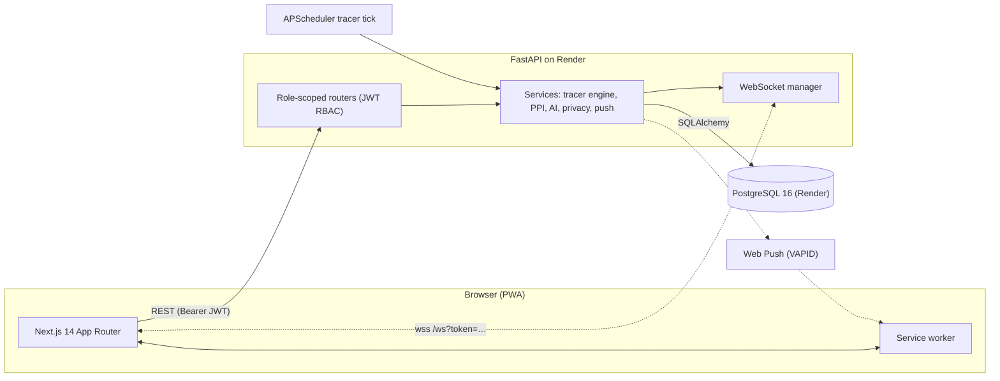
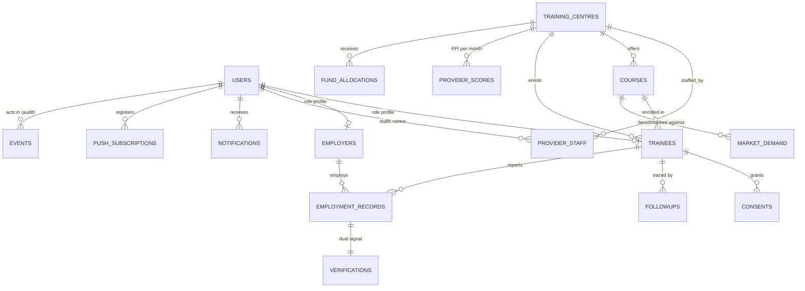

# TrackSkill AI — Capstone Report (skeleton)

> Working draft for submission. Fill the placeholder brackets ⟨…⟩ and replace
> screenshot placeholders with captures from the deployed app. Sections that
> already have real content (architecture, PPI, events, testing results) are
> drawn straight from the repository — verify numbers before submitting.

## Abstract

TrackSkill AI is a full-stack platform that closes the post-certification
data gap in vocational skilling programs. It follows trainees at 3-, 6- and
12-month milestones through consent-based digital profiles and simulated
WhatsApp/IVR/SMS tracers, verifies employment claims with dual signals
(trainee self-report + employer confirmation), maps trainee skills and
curricula to market demand with an AI matching module, and gives funders a
governance dashboard with a Provider Performance Index (PPI) that ranks
centres and guides fund allocation. The system ships as a Next.js PWA
front end, a FastAPI service, PostgreSQL persistence, and realtime
WebSocket/push delivery — deployed on Vercel and Render with CI running
lint, a 104-test suite (85.8% coverage on services and routers) and a
four-role end-to-end scenario.

⟨Polish into 150–200 words; add one headline result, e.g. “the flagship
chain propagates across all four dashboards in under 2 seconds without a
reload”.⟩

## Problem statement

Skilling programs lose sight of trainees the day they certify. Placement and
retention go unrecorded, funders cannot compare centres, and curricula drift
away from market demand. Existing MIS tools are forms-first, consent-blind
and batch — they produce no live signal, no verification, no accountability.

⟨Add 2–3 sentences of local context / statistics with a citation, e.g. a
Skill Development report — placeholders in References.⟩

## Objectives

1. **Consent-first tracing (SDG 8).** Record versioned consent per channel
   and trace outcomes at 3/6/12 months; revoking consent stops tracing
   immediately.
2. **Dual-signal verification.** An outcome counts fully only when both the
   trainee and the named employer confirm it.
3. **AI curriculum-to-market matching.** Score trainee skills and course
   curricula against market demand; surface per-course gaps.
4. **Governance analytics (PPI).** One number per centre that funders can
   act on: allocation recommendations tied to performance.
5. **Ship-able engineering.** Realtime updates, installable PWA, security
   hardening, DPDP-aligned data rights, ≥80% test coverage, CI, and a
   public deployment.

## SDG mapping

| SDG | How TrackSkill AI contributes |
| --- | --- |
| **8 — Decent Work and Economic Growth** (primary) | Measures what matters after certification: employment, retention at 12 months, wage growth. PPI ties funding to verified decent-work outcomes. |
| **4 — Quality Education** (supporting) | Curriculum-demand gap report tells training centres which modules to teach; skill assessment shows trainees where they stand. |
| **9 — Industry, Innovation and Infrastructure** (supporting) | Lightweight open infrastructure: simulated-gateway design works without telco contracts; realtime event architecture is auditable end to end. |

⟨Optional: one sentence per SDG linking to a specific screen
(provider insights, admin gap matrix) for the presentation.⟩

## Literature review / related work

⟨Placeholders — replace with real citations:⟩

- ⟨MIS for TVET/skilling: government skill-mission dashboards, source 1⟩
- ⟨Outcome tracking studies: graduate tracer study methodologies (source 2)⟩
- ⟨Consent frameworks: DPDP Act 2023 consent artifacts (source 3)⟩
- ⟨Push/SMS survey methodology in low-resource settings (source 4)⟩
- ⟨Provider scoring / performance-index literature in education (source 5)⟩
- ⟨Related products: ⟨A⟩, ⟨B⟩ — and what TrackSkill AI adds over them⟩

## System architecture

Component notes: monorepo (`apps/api`, `apps/web`); 16-table schema with
generated dual-signal verification column; event-sourced audit log drives
realtime, notifications and push; service worker gives the installed app an
offline shell, cached API data and a background-sync queue for offline
tracer responses. Deployment: Vercel (web) + Render Blueprint (API + Postgres),
CI on GitHub Actions. See [README.md](README.md#architecture).

## Database design

Key tables: `users` (single identity, role enum, demo flag), `trainees`
(nullable centre/course until provider enrols), `consents` (channel +
version + revoked_at), `followups` (milestone, state machine ENROLLED →
SCHEDULED → SENT → RESPONDED/MISSED, attempts), `verifications`
(trainee_signal, employer_signal, **generated column `verified`** true only
for CONFIRMED+CONFIRMED), `provider_scores` (PPI components per month),
`events` (append-only audit), `push_subscriptions`. Migrations: Alembic
`0001`–`0006`.

## Module description

| Module | Location | Responsibility |
| --- | --- | --- |
| Auth & RBAC | `app/services/auth_service.py`, `app/dependencies.py` | JWT access (15 min) + rotating refresh cookie, `require_role` guards, registration with profile creation |
| Tracer engine | `app/services/tracer_service.py`, `tracer_channels.py` | consent-scoped scheduling, simulated WhatsApp/IVR/SMS adapters, retries, expiry, run-now, manual-review path |
| Verification | `app/services/employer_service.py` | claim queue, confirm/dispute, dual-signal completion |
| PPI | `app/services/ppi.py` | five weighted components, monthly storage, leaderboard |
| AI matching | `app/ai/` | skill assessment, TF-IDF curriculum matcher (sentence-transformers optional), tracer reply parser, anomaly scan |
| Realtime | `app/services/realtime.py`, `app/realtime/` | publish_event fan-out: audit row + notifications + WS + push |
| Privacy | `app/services/privacy.py` | field masking, READ_AUDIT; data rights in `trainee_service.py` |
| Web shell | `apps/web/src/components/dashboard/` | DashboardShell, realtime pulse, notifications, global search |
| PWA | `apps/web/public/sw.js` | offline shell, network-first data cache, background sync, push |

## AI methodology

1. **Embedding.** 60-skill taxonomy (6 sectors). Default deterministic
   hashed n-gram embedder (`USE_LIGHT_NLP=true`) so any laptop runs it;
   optional all-MiniLM-L6-v2 semantic upgrade behind the same interface.
2. **Skill assessment.** Course skills + self-reported skills + free text →
   per-skill confidence and top-5 job-role matches (cosine similarity).
3. **Curriculum matcher.** TF-IDF over course module outlines vs demand
   skills; per-course coverage and gap score; suggested modules for the
   biggest gaps.
4. **Tracer reply parser.** Structured + free-text English replies →
   employment status/job title/wage/employer with confidence; low confidence
   routes to provider manual review.
5. **Anomaly scan.** Statistical outliers (wage, dates, confirmation spikes)
   surfaced to admins.

⟨Add one worked example with real seeded data + screenshot.⟩

## Testing results

| Suite | Command | Result |
| --- | --- | --- |
| Backend unit/integration | `pytest --cov` | 104 passed; coverage 85.8% on services+routers (gate ≥80%) |
| Flagship chain (integration) | `pytest tests/test_chain.py` | 10 passed — all four role sockets receive the exact event sequence |
| Hardening | `pytest tests/test_hardening.py` | 19 passed — headers, limits, masking, audit, revocation, data rights |
| Frontend components | `npm test` (Vitest) | 11 passed |
| End-to-end | `npx playwright test` | 4-context flagship scenario, realtime updates proven without reload |
| CI | GitHub Actions | lint + tests + build + E2E green |

⟨Paste the latest CI run link + Lighthouse PWA score before submitting.⟩

## Limitations and future scope

**Limitations.** Simulated gateways only (Twilio/Meta adapters are stubs);
rate limiter is per-process memory (needs Redis when scaling); refresh
tokens rotate but are not server-revocable (no jti denylist); realtime
invalidation is coarse (any event refetches all queries); coverage gate
covers services+routers; free-tier deployments sleep and the free database
expires in 30 days; push delivery requires HTTPS and a supported browser.

**Future scope.** Real gateway integrations with opt-in templates; offline
bulk-sync for providers with flaky networks; Hindi/regional-language tracer
NLP; employer-side skills-search with contact-through-platform workflow;
scheduled PPI batch jobs; Redis-backed rate limiting and token denylist;
per-event cache invalidation keys; accessibility audit (screen-reader
walkthrough) beyond WCAG AA basics.

## References

⟨Format per your institution's style. Starters:⟩

1. ⟨Ministry of Skill Development and Entrepreneurship — annual report⟩
2. ⟨Graduate tracer study methodology paper⟩
3. ⟨Digital Personal Data Protection Act, 2023 (India)⟩
4. ⟨Web Push protocol (RFC 8291) / VAPID (RFC 8292)⟩
5. ⟨Next.js documentation⟩ · ⟨FastAPI documentation⟩ · ⟨PostgreSQL manual⟩
6. ⟨Two TVET outcome-tracking product pages you compared against⟩
